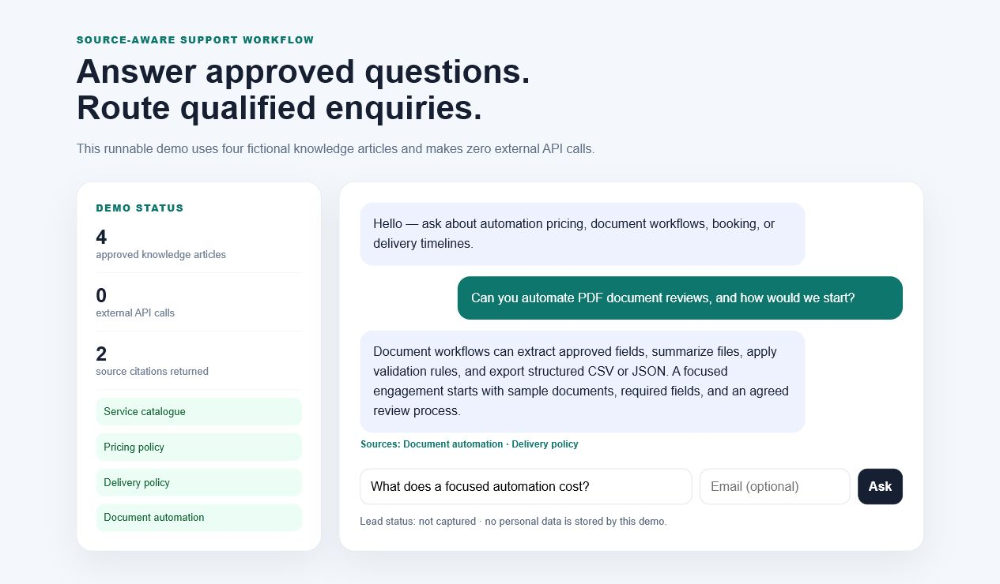

# Support & Lead Assistant

[](https://github.com/rongali-commits/support-lead-assistant/actions/workflows/ci.yml)
[Live application](https://rongali-commits.github.io/support-lead-assistant/) · [Portfolio](https://noerong.com/projects) · [Discuss an assistant](mailto:hello@noerong.com)

A source-aware FastAPI assistant that answers from an approved knowledge base, returns citations, classifies customer intent, and marks high-intent enquiries for follow-up.



## Business problem

Small service teams repeatedly answer the same questions, while generic chatbots can invent details or hide where an answer came from. This implementation keeps the workflow explicit:

```text
Question -> local retrieval -> approved answer + sources -> intent route -> follow-up status
```

## Demonstrated outcome

The included implementation is intentionally honest and reproducible:

| Measure | Demo behavior |
| --- | ---: |
| Approved knowledge articles | 4 |
| External API calls | 0 |
| Supported intent routes | 4 |
| Automated API tests | 4 |

These are implementation measurements from fictional sample content, not client performance claims.

## Features

- deterministic retrieval over an editable JSON knowledge base;
- source titles returned with every matched answer;
- pricing, booking, document, and delivery intent routes;
- optional email validation and follow-up qualification;
- safe fallback when the knowledge base has no answer;
- FastAPI documentation at `/docs` and a responsive demo interface at `/`;
- no API key, tracking, database, or personal-data storage.

## Quick start

Requires Python 3.11 or newer.

```bash
python -m venv .venv
# Windows: .venv\Scripts\activate
# macOS/Linux: source .venv/bin/activate
python -m pip install -e ".[dev]"
support-assistant
```

Open `http://127.0.0.1:8000`. Run verification with:

```bash
pytest
curl http://127.0.0.1:8000/health
```

Example API request:

```bash
curl -X POST http://127.0.0.1:8000/api/chat \
  -H "Content-Type: application/json" \
  -d '{"question":"Can you automate PDF document reviews?"}'
```

## Repository structure

```text
src/support_assistant/app.py       API, intent routing, and lead status
src/support_assistant/retrieval.py local source retrieval
src/support_assistant/static/      runnable browser interface
site/                              independently hosted browser edition
data/knowledge_base.json           fictional approved content
tests/                             API and safety-path tests
docs/                              verified screenshot
```

## Production handoff

For a real deployment, the retrieval interface can be replaced with embeddings or a managed search service while retaining source filters and fallback rules. Lead delivery would connect to the client's CRM or email provider behind authentication, consent language, rate limits, logging, and retention controls. No client content or credentials are included in this repository.

## License

MIT — see [LICENSE](LICENSE).
